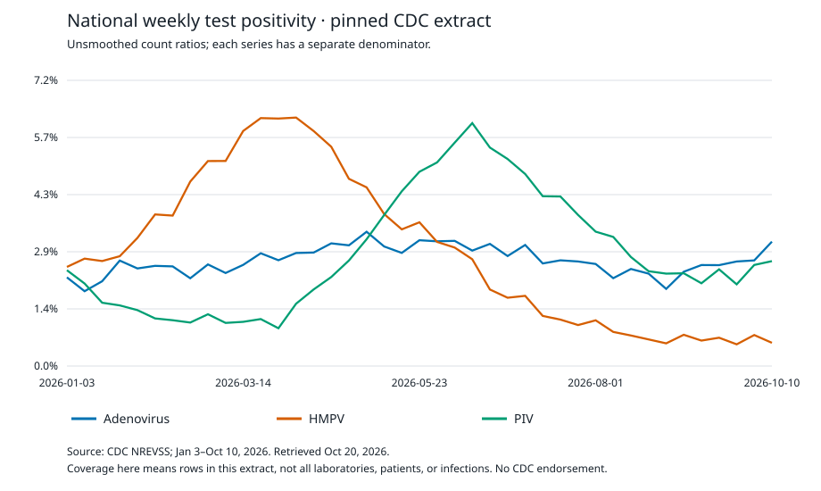

# Surveillance data quality

This project checks surveillance counts, denominators, missing reports, and revisions before interpreting a curve. It uses Python and the SQLite database engine to make those checks reproducible.

## Why this project

**Start here:** [Background, rationale, and key themes](docs/project-context.md). Then read [the biology and concepts](docs/biology-and-concepts.md) for an explanation of the measurements.

The main example checks a saved **real aggregate dataset from the Centers for Disease Control and Prevention (CDC)** National Respiratory and Enteric Virus Surveillance System (NREVSS). These aggregate data combine test results into weekly counts. The analysis checks counts and denominators, measures coverage within the requested window, and shows how leaving out recent weeks changes the summaries.

A separate tool uses synthetic report histories to reconstruct which reports were available by a given date. It excludes later revisions that an analyst could not have known at that time.

The original synthetic audit remains as a small, easy-to-inspect test case. The real data and synthetic examples are labeled separately throughout.

## What it does

The public audit verifies that a saved download meets the required file and schema rules, keeps absent and suppressed observations distinct, checks percentages against counts, and compares test counts between consecutive weeks. Those test counts are the denominators of positivity percentages.

The synthetic calendar audit uses Structured Query Language (SQL) to match records between tables. The report-history example selects revisions by issue date. The project fits no epidemiological model. See the [glossary](docs/glossary.md) for scientific and computing terms.

## Quick start

You need Python 3.12 or later. No third-party packages or network access are needed for the bundled analyses.

```sh
python src/public_audit.py --output my-results/public
python src/vintage_audit.py --output my-results/vintages
python src/audit.py --output my-results/synthetic
python -m unittest discover -s tests -v
```

Run these commands from the repository root. The public analysis verifies the pinned file's SHA-256 checksum, a fingerprint of its bytes, before reading its records. The commands write to three separate directories under `my-results/`, preserving the committed examples linked below. Omitting `--output` replaces files in the corresponding committed result directory.

| Example | Input | What to read |
| --- | --- | --- |
| Real public-data audit | 123 CDC national series-week rows from January 3–October 10, 2026 | [Results and sensitivity analysis](results_public/report.md) |
| As-of report histories | Explicitly synthetic issue dates and revisions | [Vintage analysis](results_vintages/report.md) |
| Basic SQL audit | Explicitly synthetic clinic reports with planted errors | [Basic audit](results/report.md) |

Run the preflight to check the saved download before analysis. It prints an aggregate summary without writing files:

```sh
python src/validate_snapshot.py
```

[Expected preflight output](examples/snapshot_preflight.json) and [the input/output contract](docs/practical-use.md) explain what a passing check means.

For a versioned result that a script can inspect on success or failure:

```sh
python src/validate_snapshot.py --diagnostics-json
```

The [diagnostic contract and stable codes](docs/diagnostics.md) separate malformed input, observations needing review, and informational zero-denominator findings. The default command keeps its earlier output format.

## Example results

The [denominator and window-sensitivity view](docs/denominator-visualization.md) shows weekly test counts beside the change in pooled positivity when recent weeks are excluded. It reconciles every plotted window to the saved counts and preserves each category's denominator.

All **123 requested series-week records** were present and usable in the captured file: 41 weeks for each of three categories. Their count-derived percentages agreed with the source's displayed percentages within two-decimal rounding.

| CDC series | Positive tests / tests in the selected window | Pooled positivity |
| --- | ---: | ---: |
| Adenovirus | 21,057 / 799,289 | 2.634% |
| Human metapneumovirus (HMPV) | 24,375 / 791,964 | 3.078% |
| Parainfluenza viruses (PIV) | 23,015 / 875,604 | 2.628% |

These are summaries of reported tests. A complete extract does not establish complete laboratory reporting, unique-patient coverage, population prevalence, or clinical validity. Each category keeps its own denominator; counts are never pooled across categories. This is a data-quality worked example, not an outbreak forecast.



The committed chart is a historical example. A fresh run formats its footer dates as `YYYY-MM-DD` using the snapshot metadata; this [documented maintenance change](docs/review-2026-10-21.md) changes the SVG bytes without changing the plotted values or numerical results.

The chart shows unsmoothed count ratios. The [trailing-window table](results_public/trailing_window_sensitivity.csv) reports what happens after excluding observations newer than 0, 7, 14, or 28 days before the analysis date. Every window uses the same release. This checks sensitivity to the observation window; it does not reconstruct earlier reporting vintages.

## Practical use and limitations

Use this project to practice extracting and reviewing surveillance data. The [practical guide](docs/practical-use.md) separates automated checks from the source and scientific questions you must assess.

Inspect both status and findings in diagnostic mode. Rejected input exits 2; a completed audit with row findings exits 0 and reports `status: review`. Exit 0 alone is not scientific approval.

### Inspect changing test denominators

The public audit reports consecutive-week test-count ratios in each category. By default, it flags absolute changes **greater than 50%** for review. Flags do not exclude data or change validity decisions. The setting is illustrative, not a validated surveillance threshold.

```sh
python src/public_audit.py --denominator-change-threshold 0.2 --output results_denominator_20pct
```

The [week-level diagnostic](results_public/denominator_changes.csv) reports counts, ratios, signed relative changes, and reasons a comparison was unavailable. It does not compare across a missing week; a zero previous denominator leaves the ratio undefined.

All 120 consecutive pairs in the pinned extract are evaluable, and none crosses the default 50% setting. This result does not establish stable testing practices or unbiased reporting.

See [related tools and design choices](docs/tools-and-design-notes.md) for a practical comparison with Carnegie Mellon Delphi's version-aware epidemiological data infrastructure.

### Reconstruct synthetic report histories

The separate `vintage_audit.py` command selects the newest report issued on or before `--as-of`. It distinguishes reports that are not yet due from reports that are due but still absent. Revisions replace earlier counts, including downward corrections. Conflicting same-date versions fail validation, and an invalid newest report stays flagged rather than silently reverting to an older value.

```sh
python src/vintage_audit.py --as-of 2026-10-12 --grace-days 7 --output results_vintage_oct12
```

The included histories are invented. For the October 20 cutoff, eight of nine due slots have usable reports, one is absent, and three selected reports have revisions. The seven-day grace period is a demonstration choice. This is not a measurement of CDC reporting delays.

[Mellor et al. (2026)](https://pubmed.ncbi.nlm.nih.gov/42832413/) explain why reporting dates and backfilled revisions matter when judging surveillance data retrospectively. Our [methods](docs/public-data-methods.md) connect that reasoning to the implementation and make its limits explicit. The published NREVSS analysis by [Silk et al. (2026)](https://pubmed.ncbi.nlm.nih.gov/41712508/) also discusses participation and representativeness constraints; this repository does not reproduce that article's results.

### Capture and compare a future release

Fetching is optional and requires an internet connection. The adapter downloads the same defined series and date window into a **new** directory, validates the schema, and records provenance. It refuses to overwrite an earlier capture.

```sh
python src/fetch_public.py --output snapshots/new_capture
python src/public_audit.py --snapshot snapshots/new_capture --output results_new_capture
python src/compare_snapshots.py --old data/public --new snapshots/new_capture --output results_comparison
```

The comparison preserves both releases and reports changed counts, percentages, and availability statuses. Only one real capture is included, so the project cannot estimate a historical revision rate.

The adapter treats `posted` as release/update-date metadata. The captured metadata do not establish a specimen, testing, or individual laboratory submission time; see the [timing assumptions](docs/assumptions.md).

## Documentation

| Guide | What it covers |
| --- | --- |
| [Glossary](docs/glossary.md) | Scientific and computing terms in plain language |
| [Assumptions](docs/assumptions.md) | Reasons, checks, and consequences if assumptions fail |
| [References](docs/references.md) | Complete citations and the role of each source |
| [Reference audit](docs/reference-audit.json) | Source-by-source verification and access limits |
| [Editorial and scientific review](docs/review-2026-10-20.md) | Corrections and checks in this review |
| [Maintenance and source review](docs/review-2026-10-21.md) | Current fixes, source checks, validation, and remaining limits |
| [Project context](docs/project-context.md) | Background, rationale, and key themes |
| [Biology and concepts](docs/biology-and-concepts.md) | What respiratory test positivity measures |
| [Public methods and references](docs/public-data-methods.md) | Calculation choices, limitations, and scientific sources |
| [Synthetic SQL methods](docs/methods.md) | Original audit methods and supporting references |
| [Public data dictionary](docs/public-data-dictionary.md) | Aggregate and report-vintage fields |
| [Synthetic dictionary](docs/data-dictionary.md) | Original synthetic clinic schema |
| [Data provenance](data/public/manifest.json) | Exact source query, hashes, timestamp, and reuse note |
| [Practical use](docs/practical-use.md) | Input/output contract, worked use, failure behavior, next steps |
| [Literature review](docs/literature-review.md) | Bounded evidence appraisal and implementation consequences |
| [Search log](docs/search-log.json) | Exact searches, retrieved IDs, and screening decisions |
| [Round 2 evidence update](docs/search-update-02.json) | Same-day, narrower search supporting reusable diagnostics |
| [Diagnostic contract](docs/diagnostics.md) | Versioned fields, stable codes, severity and exit behavior |
| [Related tools](docs/tools-and-design-notes.md) | Comparison with Delphi's version-aware data infrastructure |

## Development and reuse

Run `python -m unittest discover -s tests -v`. Tests include malformed manifests, metadata/schema identity, unchanged input files, missing versus zero, duplicate quarantine, revision cutoffs, and undefined denominator ratios. Review [contribution and reproducibility expectations](CONTRIBUTING.md) before adapting the schema.

Source: **CDC NREVSS**. The raw public records are retained unedited and are also available free from the [CDC dataset](https://data.cdc.gov/Laboratory-Surveillance/Percent-positivity-of-respiratory-viruses-by-nucle/rgnm-fkqb). Use of these materials and links does not imply endorsement by CDC, the Department of Health and Human Services (HHS), or the U.S. government. See [CDC's reuse policy](https://www.cdc.gov/other/agencymaterials.html) and the manifest's license note. Repository code uses the MIT license; the synthetic fixtures were generated for this project.
