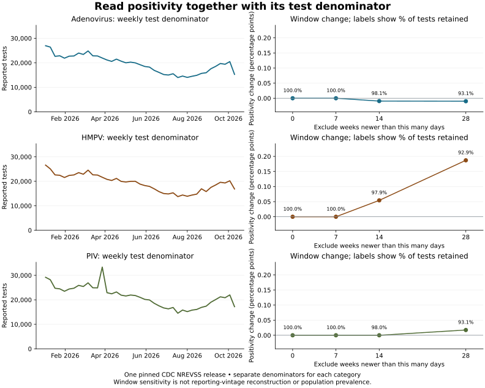

# Put the denominator beside the comparison

The existing weekly positivity chart is supplemented by a view of **reported test counts** and the **change in pooled positivity after excluding recent weeks**. Each category retains its own denominator. The right-hand panels annotate how much of that category's test denominator remains in each window.



For the pinned release, excluding weeks newer than 28 days retains about 93% of tests in each category. The HMPV pooled percentage rises by about 0.187 percentage points; the Adenovirus and PIV changes are smaller. These numbers are directly reconciled to the saved weekly counts. They describe sensitivity to an observation window within one release, not historical revisions, laboratory completeness, or population prevalence. See the [source methods](public-data-methods.md) and [original report](../results_public/report.md).

## Reproduction and checks

The audit remains dependency-free. Use a separate optional plotting environment with Python 3.12 or later:

```sh
python -m pip install -r requirements-visualization.txt
python src/plot_denominator_context.py --input-dir results_public --output-dir docs/figures/denominator-context
python -m unittest discover -s tests -v
```

The plot command writes SVG, PNG, and `provenance.json` with source hashes and the plotting version. It replaces those three generated files in the selected directory and leaves the captured input and historical reports unchanged. The SVG can be edited in Inkscape; regenerate its numerical content from the script.

Before plotting, the script checks unique weekly identities, explicit calendar slots, recognized availability states, valid usable counts, and every sensitivity table count, ratio, and percentage-point change against the weekly audit. Exclusion-day labels and their cutoff dates must imply one common analysis date, and a zero-day baseline must cover the full weekly table. Unusable observations remain gaps, and undefined ratios remain blank; neither becomes a zero. These consistency checks cannot authenticate the source or establish epidemiological validity.

The October 27 Windows check also identified a checkout issue: Git converted the captured metadata JSON to CRLF, breaking its exact-byte fingerprint. The captured JSON files now have an explicit `-text` attribute, retaining their original bytes without changing the manifest or weakening verification. A Windows CI job exercises a fresh checkout with automatic line-ending conversion enabled and runs the snapshot preflight and test suite.
